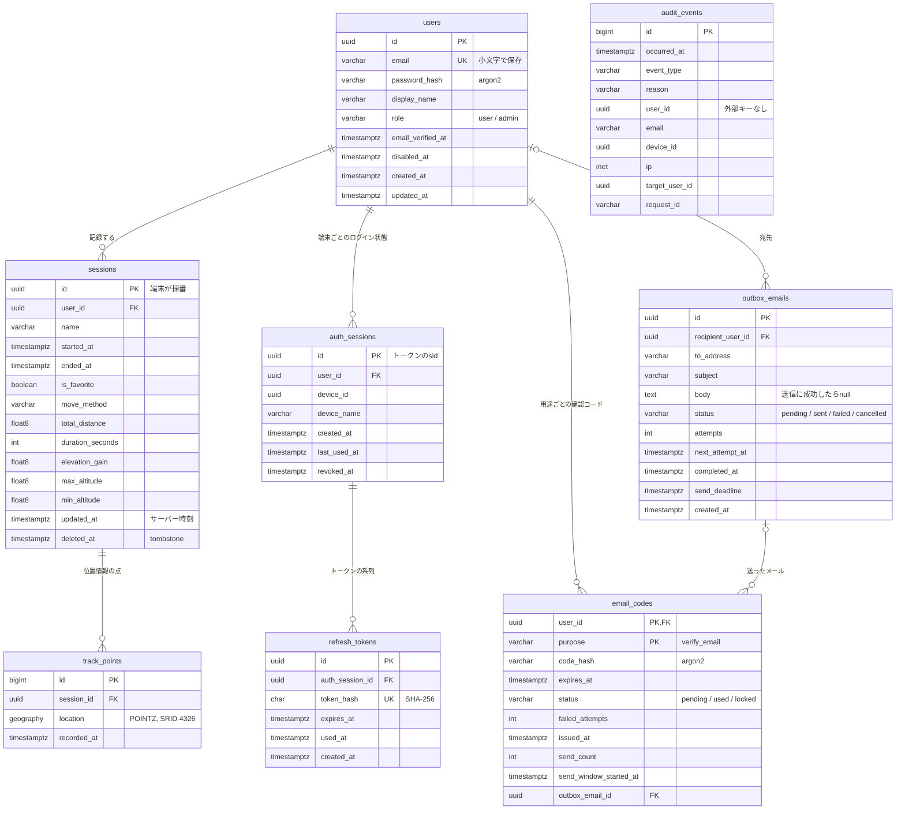
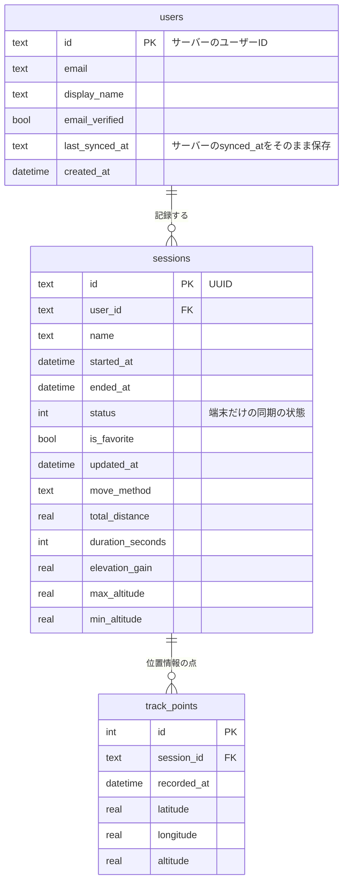
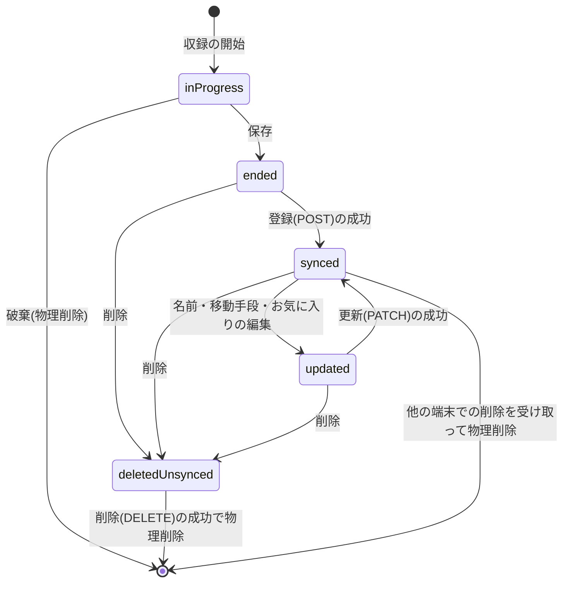

# データ設計

基本設計書の4本目。サーバー(PostgreSQL)と端末(SQLite)に持つデータの構造、両者の対応、データの状態と保持期間をまとめる。
2026-10-15時点のmainの実装を正とする。列の定義の正は、サーバーは`backend/app/models/`(SQLAlchemy)と`backend/migrations/`(Alembic)、
端末は`frontend/lib/database/app_database.dart`(Drift)にある。

## データの置き場所

| 置き場所 | 持つデータ | 正とするもの |
|---|---|---|
| サーバーのDB(PostgreSQL + PostGIS) | ユーザー・ログイン状態・トークン・記録(セッションと位置情報の点)・メール | 同期したデータの正(他の端末と共有する) |
| 端末のDB(SQLite、Drift) | この端末でログインしたユーザーの写しと、その記録 | 収録中・未同期のデータの正。オフラインでも読み書きできる |
| 端末のsecure storage(Keychain / Keystore) | 端末ID・ログイン中のユーザーID・アクセストークン・リフレッシュトークン | — |

パスワードは端末に保存しない。サーバーにもargon2のハッシュだけを保存する。

## サーバーのデータ

### ER図

`audit_events`は他のテーブルと外部キーで結ばない(アカウントの削除の記録を、ユーザーを消した後も残すため)。

### テーブル一覧

| テーブル | 内容 | 主な制約・方針 |
|---|---|---|
| `users` | ユーザー | メールアドレスは小文字で保存して一意にする。`email_verified_at`がnullの間は同期できない。`disabled_at`はアカウントの停止(削除ではない) |
| `sessions` | 記録(セッション) | idは端末が採番したUUID(オフラインで作るため)。削除は`deleted_at`を入れるtombstone方式 |
| `track_points` | 位置情報の点 | 経度・緯度・高度をPostGISの`geography(POINTZ, 4326)`の1列に持つ。空間インデックスは作っていない |
| `auth_sessions` | 端末ごとのログイン状態(1回のログインで1行) | 同じユーザー・同じ端末の有効な行は1つだけ(部分一意インデックス)。`revoked_at`を入れると、その端末のトークンは全て使えなくなる |
| `refresh_tokens` | リフレッシュトークン(更新のたびに1行) | トークンそのものは持たずSHA-256だけ。使用済み(`used_at`)の行は、再使用の検知のため有効期限まで残す |
| `email_codes` | メールで送る確認コード(ユーザーと用途ごとに1行) | コードはargon2のハッシュだけ。間違えた回数・24時間の送信回数をここで数える。用途は今は`verify_email`だけ |
| `audit_events` | 監査ログ(認証・アカウント・権限の出来事) | 追記のみ。正常な流れでも頻繁に起きる失敗(トークンの期限切れ・メール未確認の403等)は残さない。詳細は`backend/docs/バックエンド構成.md`の「監査ログ」 |
| `outbox_emails` | 送信待ちのメールと送信の記録 | apiは業務のデータと同じトランザクションで積むだけで、送るのはworker。送信に成功したら本文を消す(確認コードが平文で入るため) |

外部キーは全て`ON DELETE CASCADE`にしている(`email_codes.outbox_email_id`だけ`SET NULL`)。アカウントを削除すると、そのユーザーの
記録・ログイン状態・確認コード・メールの記録がまとめて消える。

### 移動手段の値

`sessions.move_method`は`walk`・`run`・`bicycle`・`car`・`train`・`plane`・`ship`のいずれか(端末の`MoveMethod`と同じ名前)。

### DBのロール

| ロール | 権限 | 使う場面 |
|---|---|---|
| マイグレーション用(`MIGRATOR_DB_USER`) | テーブルの作成・変更(テーブルの所有者) | Alembicのマイグレーション、`db/seed.sql`の投入 |
| アプリ用(`APP_DB_USER`) | データの読み書き(SELECT / INSERT / UPDATE / DELETE)だけ | api・worker |

ロールは`backend/db/init/`がDBコンテナの初回起動時に作る。詳細は`backend/docs/バックエンド構成.md`の「DBのロールと接続」。

## 端末のデータ

### ER図

### テーブル一覧

| テーブル | 内容 | 主な制約・方針 |
|---|---|---|
| `users` | この端末でログインしたユーザー(サーバーの`users`の写し) | 差分取得の基準時刻`last_synced_at`をユーザーごとに持つ |
| `sessions` | 記録(セッション) | ユーザーごとに分けて持つ(`user_id`で絞る)。同期の状態を`status`で持つ(下記) |
| `track_points` | 位置情報の点 | 緯度・経度・高度を別々の列に持つ |

- 外部キーはDBを開くたびに`PRAGMA foreign_keys = ON`で有効にし、`ON DELETE CASCADE`で消す。アカウントの削除時は`users`の行を消せば
  その記録もまとめて消える
- `sessions.user_id`は`ON UPDATE CASCADE`にしている(予定のローカルアカウントを通常のアカウントへ変えるときに、ユーザーIDを差し替えるため)
- スキーマのバージョンは2(2で`users`を追加し、`sessions.user_id`に外部キーを付けた)

### secure storageのキー

| キー | 内容 |
|---|---|
| `device_id` | 端末ID。初回起動時に生成するUUID(OSがハードウェアの識別子を提供しないため)。ログイン時にサーバーへ送り、`auth_sessions.device_id`になる |
| `current_user_id` | ログイン中のユーザーID。起動時のログイン状態の復元に使う |
| `access_token` | アクセストークン(ES256のJWT、15分) |
| `refresh_token` | リフレッシュトークン(30日) |

## 端末とサーバーの対応

同期では、記録を次のように変換してやり取りする。APIの形は`backend/docs/API設計ドラフト.md`。

| 端末(`sessions` / `track_points`) | サーバー | 備考 |
|---|---|---|
| `sessions.id` | `sessions.id` | 端末が採番したUUIDをそのまま使う。登録で衝突したら(409 `id_conflicted`)端末で振り直す |
| `sessions.user_id` | `sessions.user_id` | サーバーは端末の申告ではなく、アクセストークンのユーザーで決める |
| `name`・`move_method`・`is_favorite` | 同じ名前の列 | 端末で編集できる3項目。更新(PATCH)では毎回3つとも送る |
| `started_at`・`ended_at`・集計値(距離・時間・獲得標高・最高/最低高度) | 同じ名前の列 | 登録の後は変えない |
| `updated_at` | `updated_at` | サーバーが付ける。端末は登録・更新の応答の値で上書きする(端末で編集した時点では端末の時刻が入る) |
| `status` | (無い) | 端末だけの同期の状態 |
| (無い) | `deleted_at` | サーバーだけのtombstone。差分取得で削除されたことを受け取ったら、端末は行を物理削除する |
| (無い) | `users.last_synced_at`(端末) | 差分取得の基準時刻。サーバーが返した`synced_at`を端末がそのまま保存して次に送る |
| `track_points.latitude`・`longitude`・`altitude` | `track_points.location`(POINTZ) | APIでは緯度・経度・高度の3つの数値でやり取りする。高度はAPIでは必須で、端末の列はnull可だが、収録ではgeolocatorの高度を常に入れている |
| `track_points.recorded_at` | `track_points.recorded_at` | 位置情報を取得した時刻(`Position.timestamp`) |

時刻はAPIでは全てUTC(ISO 8601、`Z`付き)でやり取りする。

## データの状態

### 端末の記録の同期の状態(`sessions.status`)

| 状態 | 意味 |
|---|---|
| `inProgress` | 収録中、または保存/破棄が未確定(アプリが落ちた場合は次の起動時に回収する)。一覧・同期の対象外 |
| `ended` | 保存したが、サーバーへの登録が確認できていない |
| `synced` | サーバーと一致している |
| `updated` | 同期した後に端末で編集した |
| `deletedUnsynced` | 端末で削除したが、サーバーでの削除が確認できていない。一覧には出さない |

- `ended`のまま編集しても`ended`のまま(次の登録で編集後の値を送る)
- `ended`の行を削除してもDELETEを送る(登録のPOSTがサーバーでは成功していて、応答だけが届かなかった場合があるため)
- 他の端末で削除された記録を`updated`のまま持っていた場合は、削除と編集の競合としてユーザーに選ばせる(`docs/design/sync.md`)

### サーバーの記録の削除(tombstone)

記録の削除は、`deleted_at`と`updated_at`に削除した日時を入れる論理削除にする。他の端末が通常の差分取得の中で「削除された」ことを
受け取れるようにするため。削除した記録は、パージまでの間なら削除の取り消し(restore)で復活できる。

## データの保持期間

| データ | 保持期間 | 消し方 |
|---|---|---|
| 記録のtombstone(`sessions.deleted_at`が入った行) | 削除から90日(`PURGE_RETENTION_DAYS`) | workerが24時間ごとに物理削除する。90日より前に同期したきりの端末には、差分取得が突き合わせ(existence-check)を求める |
| リフレッシュトークン | 有効期限(30日)まで | 期限を過ぎたものをworkerが物理削除する |
| 無効にしたログイン状態(`auth_sessions.revoked_at`が入った行) | 無効にしてから30日 | workerが物理削除する |
| メールの送信の記録(`outbox_emails`) | 送信済み(`sent`)・諦めた(`failed`)・取り消した(`cancelled`)行は作成から90日(`OUTBOX_RETENTION_DAYS`) | workerが物理削除する。本文は送信に成功した時点で消す。送信待ち(`pending`)の行は消さない |
| 監査ログ(`audit_events`) | 記録から90日(`AUDIT_EVENT_RETENTION_DAYS`) | workerが物理削除する |
| ユーザーと、その全てのデータ | アカウントを削除するまで | アカウントの削除で、サーバー・端末とも物理削除する。監査ログもそのユーザーの記録を消し、削除の記録(日時と`user_id`だけ)を残す |
| 端末の`deletedUnsynced`の行 | サーバーでの削除が確認できるまで | 削除(DELETE)の成功、またはサーバーに無いことの確認で物理削除する |
