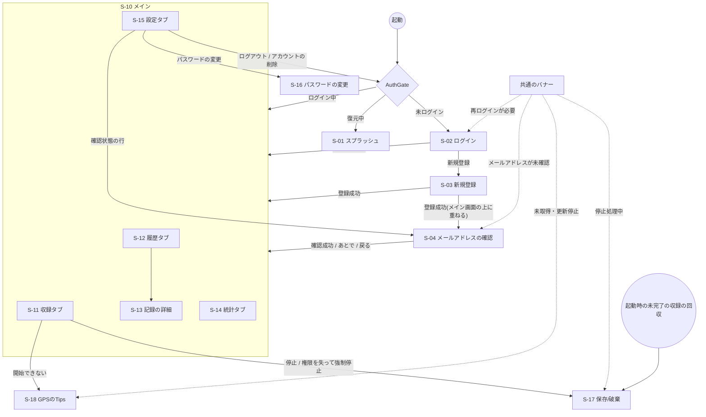

# 画面一覧・画面遷移

基本設計書の3本目。アプリの画面・ダイアログ・バナーの一覧と、画面の遷移をまとめる。2026-10-15時点のmainの実装を正とする。
画面ごとの細かい挙動(入力の検証・エラーの表示等)は`docs/design/screens.md`、収録・保存/破棄の流れは
`docs/design/location-tracking.md`・`docs/design/session-recovery.md`を参照。機能ID(F-xxx)は`features.md`のもの。

## 画面構成の方針

- 起動時の画面は`main.dart`の`AuthGate`が、ログインの状態に合わせて切り替える(ログイン状態の復元中はスプラッシュ、
  未ログインならログイン画面、ログイン中ならメイン画面)。ログイン・ログアウトしたときも、画面の遷移ではなくこの切り替えで画面が変わる
- メイン画面は下部のナビゲーションバーで4つのタブ(収録・履歴・統計・設定)を切り替える。タブは`IndexedStack`で持つので、
  切り替えても各タブの状態(スクロール位置等)は残る
- 履歴タブだけはタブの中に自前の`Navigator`を持ち、記録の詳細をタブの中に重ねる(詳細を開いてもナビゲーションバーが残る)
- メイン画面の上部には、全タブ共通のバナー(収録の状態・位置情報・認証)を出す
- 保存/破棄の画面など、UIの外(`TrackingService`等)から開く画面は、アプリ全体の`navigatorKey`で開く

## 画面一覧

| ID | 画面 | ファイル(`frontend/lib/`) | 概要 | 主な機能 |
|---|---|---|---|---|
| S-01 | スプラッシュ | `main.dart`(`AuthGate`) | ログイン状態の復元中に表示する | F-ACC-03 |
| S-02 | ログイン | `views/auth/login_page.dart` | メールアドレスとパスワードでログインする。新規登録への導線 | F-ACC-02 |
| S-03 | 新規登録 | `views/auth/signup_page.dart` | メールアドレス・パスワード・表示名で登録する | F-ACC-01 |
| S-04 | メールアドレスの確認 | `views/auth/email_verification_page.dart` | 6桁の確認コードの入力と再発行 | F-ACC-04 |
| S-10 | メイン | `views/main_page.dart` | 4つのタブの枠と共通のバナー | — |
| S-11 | 収録タブ | `views/recording_page.dart` | 地図と現在地、収録の開始・停止、収録中の距離・時間 | F-REC-01〜04 |
| S-12 | 履歴タブ(記録の一覧) | `views/saved_sessions.dart` | 保存した記録の一覧。編集モードで記録の編集・削除 | F-HIS-01、03、04 |
| S-13 | 記録の詳細 | `views/session_detail_view.dart` | 軌跡の地図(ルート/全ピン)、集計値、高度のグラフ | F-HIS-02 |
| S-14 | 統計タブ | `views/analytics_page.dart` | 期間ごとのグラフ、サマリー、自己ベスト | F-STA-01〜03 |
| S-15 | 設定タブ | `views/settings_page.dart` | 表示名・メールアドレスの確認状態・パスワードの変更・ログアウト・アカウントの削除 | F-ACC-04〜09 |
| S-16 | パスワードの変更 | `views/auth/change_password_page.dart` | 現在のパスワードと新しいパスワードを入力する | F-ACC-07 |
| S-17 | 保存/破棄 | `views/save_or_discard_page.dart` | 収録を止めた後に、記録を詳細と同じ見た目で見せて保存か破棄を選ばせる。全画面のダイアログとして開く | F-REC-06〜08 |
| S-18 | GPSのTips | `views/gps_help_page.dart` | GPSを掴みやすくするためのTips | F-REC-02 |

## 共通のバナー

メイン画面(S-10)の上部に、全タブ共通で表示する。表示するものが無いときは高さを取らない。

| バナー | ファイル(`frontend/lib/widgets/`) | 表示する条件 | タップ・ボタンの動作 |
|---|---|---|---|
| 収録の状態 | `recording_phase_banner_view.dart` | 収録の準備中・収録中・停止処理中(保存/破棄が未確定) | 停止処理中のときだけ、タップで保存/破棄(S-17)を開き直す |
| 位置情報 | `location_banner_view.dart` | 権限が無い・位置情報サービスがオフ・未取得・更新停止・精度低下(1つだけ表示) | 「設定を開く」でOSの設定アプリを開く。未取得・更新停止のときはGPSのTips(S-18)へのリンク |
| 認証 | `auth_banner_view.dart` | 再ログインが必要・メールアドレスが未確認 | 再ログインならログイン(S-02、ログインしたら閉じて元の画面に戻る)、未確認ならメールアドレスの確認(S-04)を開く |

## 画面遷移図

補足:

- 保存/破棄(S-17)は×で閉じられるが、保存か破棄をするまで収録は「停止処理中」のまま残る。収録タブの「前回のセッションを処理」ボタン、
  共通のバナー、収録タブ以外にいるときのスナックバーから開き直せる(`docs/design/session-recovery.md`)
- 起動時の未完了の収録が複数あるときは、保存/破棄(S-17)を1件ずつ差し替えて順に出す
- ログアウト・アカウントの削除は収録中はできない(スナックバーで止める)

## ダイアログ一覧

| 開く画面 | ダイアログ | 内容 |
|---|---|---|
| 収録タブ(S-11) | 最後の位置から開始 | 現在地を取得できないとき、15秒以内に確認できた位置から収録を始めるかを聞く(`tracking_service.dart`) |
| 収録タブ(S-11) | 収録を開始できません | 開始できる位置が無いとき。再試行・GPSのTipsへのリンク |
| 収録タブ(S-11) | トラッキングを停止しますか? | 停止の確認(継続/停止) |
| 保存/破棄(S-17) | セッション保存 | 名前(空欄なら日時と移動手段から既定の名前を付ける)と移動手段を入れて保存する |
| 保存/破棄(S-17) | セッション破棄 | 破棄の確認 |
| 履歴タブ(S-12) | セッションを編集 | 名前と移動手段の変更 |
| 履歴タブ(S-12) | セッションを削除しますか? | 削除の確認 |
| (同期の処理から) | 削除と編集の競合 | 他の端末で削除された記録を編集していたとき、削除を受け入れるか、復活させるかを選ばせる(`utils/delete_conflict_dialog.dart`) |
| 設定タブ(S-15) | 表示名の編集 | 1〜50文字 |
| 設定タブ(S-15) | ログアウトしますか? | ログアウトの確認 |
| 設定タブ(S-15) | アカウントを削除しますか? | 削除の確認(サーバーとこの端末から記録が全て消え、元に戻せない) |
