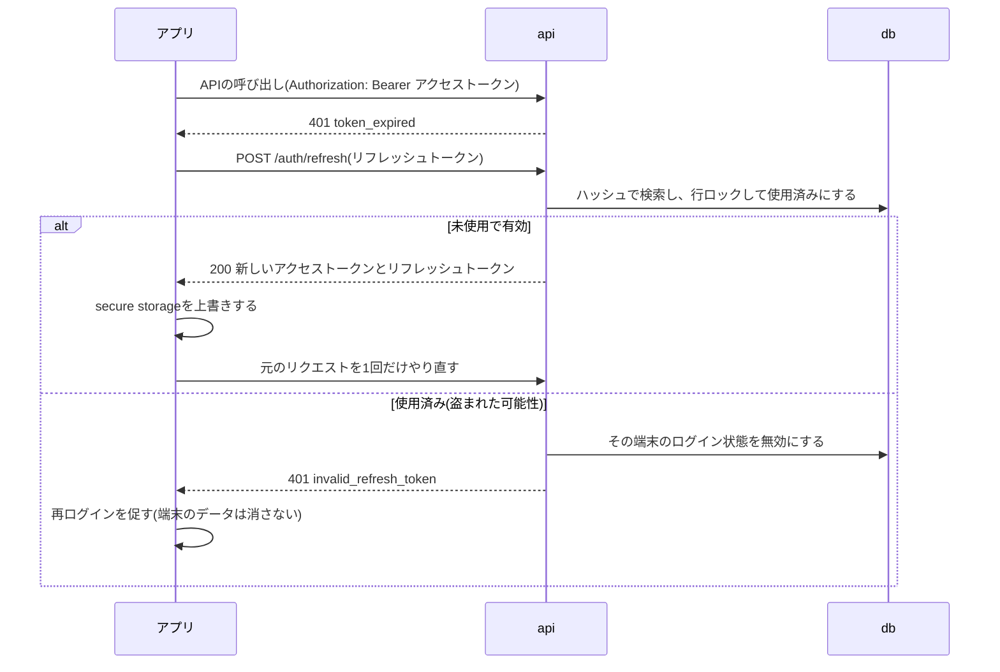

# 認証・セキュリティ

基本設計書の6本目。認証・認可の方式、秘密情報とデータの保護、悪用への対策、端末の権限とプライバシー、未対応のリスクをまとめる。
2026-10-15時点のmainの実装を正とする。実装方針の詳細は`backend/docs/バックエンド構成.md`の「認証」、エンドポイントごとの判定は
`backend/docs/API設計ドラフト.md`の「認証と権限」、決定の経緯は`docs/plans/user-feature-plan.md`の「決定事項」。

## 前提

- 個人向けのアプリで、今は開発環境しか無い(本番環境は無い)
- 認証基盤は外部サービスに任せず自前で実装する(仕組みを理解するため)。外部サービスでのログイン(OAuth)は後で対応させる予定(`features.md`)
- 扱う個人情報は、メールアドレス・表示名と、位置情報の履歴(行動の記録)。位置情報の履歴は生活圏が分かるので、他のユーザーから見えないことを最優先にする

## 認証

### 方式

| 要素 | 方式 | 保存場所 |
|---|---|---|
| パスワード | 8〜128文字、文字の種類は強制しない。MFAは無い。argon2(pwdlibの既定の設定)でハッシュにする | サーバーの`users.password_hash`。端末には保存しない |
| アクセストークン | ES256で署名したJWT、15分。中身は`sub`(ユーザーID)・`sid`(端末ごとのログイン状態のID)・`type`・`iat`・`exp`。ロールは入れない | 端末のsecure storage |
| リフレッシュトークン | 256ビットの乱数、30日。使うたびに新しいものと取り替える(ローテーション) | 端末のsecure storage。サーバーにはSHA-256のハッシュだけ |
| 端末ごとのログイン状態 | 1回のログインで1行。端末ID(初回起動時に作るUUID)を持ち、同じユーザー・同じ端末で有効なものは1つだけ | サーバーの`auth_sessions` |
| メールアドレスの確認 | 6桁のコード、10分。同じコードで5回間違えたら使えなくなる | サーバーの`email_codes`(argon2のハッシュだけ) |

- ES256(公開鍵方式)にしたのは、将来、別のサービスでもトークンを検証できるようにするため
- アクセストークンもリクエストのたびにDBで、ユーザーが存在し停止されていないこと・`sid`のログイン状態が無効になっていないことを確かめる。
  JWTの「DBを見ずに検証できる」利点は使わず、ログアウト・アカウントの停止や削除をすぐに反映することを優先した
- メールアドレスの確認前もログインはできる。止まるのは同期だけ

### トークンの更新

使用済みのリフレッシュトークンが使われた場合、無効にするのはその端末のログイン状態だけにする。アカウントはロックしない。
圏外で応答が届かず、端末が古いトークンで再試行した場合にも起きるため。

### ログイン状態を無効にする操作

| 操作 | 無効にする範囲 |
|---|---|
| ログアウト | その端末のログイン状態 |
| 同じ端末での再ログイン | その端末の前のログイン状態 |
| 使用済みのリフレッシュトークンの再使用 | その端末のログイン状態 |
| パスワードの変更 | 変更した端末以外の全てのログイン状態(変更を知らせるメールも送る) |
| アカウントの停止(運用者がCLIで行う) | そのユーザーの全てのログイン状態。停止を解除しても、前のトークンは使えない |
| アカウントの削除 | ユーザーごと物理削除する。他の端末は次のリクエストで401になる |

## 認可

| ルール | 実装 |
|---|---|
| 一般ユーザーは自分のデータだけを扱える | 同期APIのパスの`user_id`とトークンのユーザーを比べ、違えば403(`forbidden`)。`user_id`はクライアントの申告ではなくトークンで決める |
| 管理者は他のユーザーのデータも扱える | ロール(`users.role`)はトークンに入れず、リクエストのたびにDBから読む(ロールの変更をすぐ反映するため) |
| 同期はメールアドレスが確認済みのユーザーだけ | 未確認なら403(`email_not_verified`) |
| 他のユーザーの存在を知られない | 一般ユーザーには`user_not_found`(404)を返さない(他人の`user_id`は403で止まる) |
| 端末のデータもユーザーごとに分ける | 端末のDBの記録は`user_id`で絞って読み書きする。メイン画面はユーザーIDごとに作り直し、前のユーザーの画面の状態を引き継がない |

データの分離は今はアプリ層だけで行っている。DBの行レベルセキュリティ(RLS)を加えるのは予定(`features.md`)。

## 秘密情報とデータの保護

| 対象 | 保護の方法 |
|---|---|
| JWTの署名鍵(ES256の秘密鍵) | `backend/secrets/`に置き、apiにだけ読み取り専用でマウントする。コミットしない(`.gitignore`済み) |
| DBのパスワード・SMTPの設定 | `backend/.env`(コミットしない)。composeが各サービスに必要な項目だけを渡す(例: workerにはマイグレーション用のロールを渡さない) |
| DBの権限 | api・workerはデータの読み書きだけができるロールで接続する。テーブルの作成・変更はマイグレーション用のロールだけ(`data.md`の「DBのロール」) |
| パスワード・確認コード | argon2のハッシュだけを保存する |
| リフレッシュトークン | SHA-256のハッシュだけを保存する(十分にランダムなので、遅いハッシュは要らない) |
| メールの本文 | 確認コードが平文で入るので、送信に成功したら`outbox_emails.body`を消す |
| 端末のトークン | flutter_secure_storage(iOSはKeychain、AndroidはKeystoreで暗号化)に保存する。設定は既定のまま |
| 端末の記録 | SQLiteのファイルに保存する。暗号化はしていない(OSのアプリごとの領域の保護に頼る) |
| エラーの応答 | 500の原因(スタックトレース等)はサーバーのログにだけ出し、応答には含めない |

鍵・DBのパスワードのローテーションは行わない(個人開発の規模のため)。

## 悪用への対策

| 脅威 | 対策 |
|---|---|
| ログインでのアカウントの有無の推測 | 「メールアドレスが無い」と「パスワードが違う」を同じ`invalid_credentials`で返す。ユーザーが無い場合もダミーのハッシュで検証して、応答時間で区別できないようにする |
| 新規登録でのアカウントの有無の推測 | **対策していない**。登録済みのメールアドレスには409(`email_already_registered`)を返すので、登録の有無が分かる。個人向けアプリなので許容した |
| 確認コードの総当たり | 1つのコードで5回まで。有効期限は10分 |
| 確認コードのメールの大量送信 | 再送は60秒あけて、24時間で5回まで(429と`Retry-After`) |
| パスワードの総当たり | **対策していない**。ログインの試行回数の制限は予定(監査ログとあわせて) |
| 大きなリクエストによる負荷 | bodyを10MBまでにする(413) |
| リフレッシュトークンの盗用 | ローテーションと、使用済みのトークンの再使用の検知 |
| 不正な利用の見逃し | 監査ログ(`audit_events`)に、ログインの成功・失敗、パスワードの変更、トークンの再使用、他人のデータへのアクセス(403)、管理者の操作などを90日残す(`backend/docs/バックエンド構成.md`の「監査ログ」) |

## 端末の権限とプライバシー

| 項目 | 内容 |
|---|---|
| 位置情報の権限 | 「使用中のみ許可」で足りるようにしている(収録中はForeground Service / バックグラウンドの位置情報の更新で継続する)。Androidの`ACCESS_BACKGROUND_LOCATION`は要求しない |
| 通知の権限 | Android 13以降で、収録中の常駐通知のために要求する(拒否されても収録はできる) |
| 位置情報を取る範囲 | 収録していない間は、バックグラウンドで位置情報の購読を止める(`docs/design/background-recording.md`) |
| 地図タイル | OpenStreetMapのタイルサーバーへ端末から直接取りに行くので、表示している範囲(おおよその位置)がタイルサーバーに伝わる |
| アカウントの削除 | アプリの中から、アカウントと関連するデータをサーバー・端末とも物理削除できる(App Store・Google Playの審査で求められる要件) |

## 未対応・既知のリスク

リリースや本番環境を用意する前に対応が必要なもの。

| 項目 | 現状 | 対応 |
|---|---|---|
| 通信の暗号化 | apiは`http://`で動いている(開発環境)。アプリにもHTTPS以外を許可する設定(AndroidのcleartextやiOSのATSの例外)は入れていない | 本番環境ではHTTPSで公開する |
| パスワードの総当たり | 試行回数の制限が無い | 予定(ログインの試行回数の制限) |
| DBでのデータの分離 | アプリ層だけで行っている | 予定(RLS) |
| MFA | 無い | 未定 |
| 新規登録でのアカウントの有無の推測 | 409で分かる | 許容している(上記) |
| 端末のDBの暗号化 | していない | 未定 |
| プライバシーポリシー | 無い | 予定(「このアプリについて」) |
