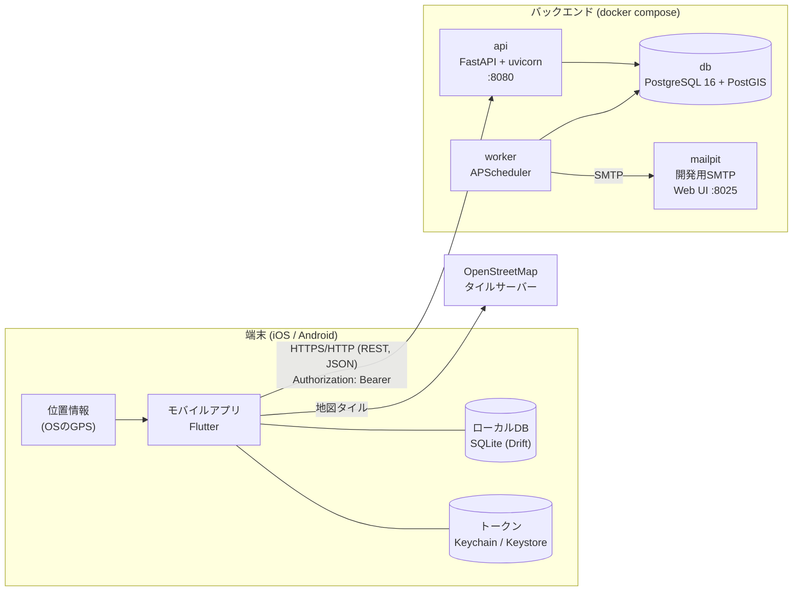
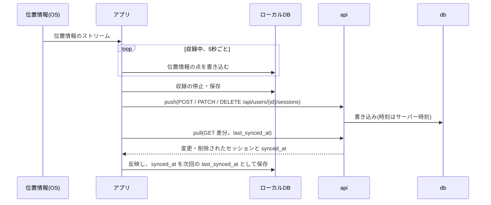

# システム概要

基本設計書の1本目。システム全体の構成と主なデータの流れをまとめる。2026-10-15時点のmainの実装を正として書き、
未実装のものは「予定」と明記する。個々の仕組みの詳細は末尾の「関連文書」から辿る。

## 目的

散歩などの移動を記録するモバイルアプリ。収録中は数秒おきに現在位置を端末に記録し、地図上の軌跡・距離・時間として
振り返れるようにする。記録はサーバーと同期し、同じユーザーの別の端末からも見られる。

開発の目的は、次に配属される案件のキャッチアップ(位置情報・オフラインファースト・REST API・認証)の実践演習である
(経緯はリポジトリ直下の`CLAUDE.md`)。

## システム構成図

## 構成要素

| 構成要素 | 役割 | 実装 |
|---|---|---|
| モバイルアプリ | 位置情報の収録、記録の閲覧・編集・統計、ログイン・登録、サーバーとの同期 | `frontend/`(Flutter / Riverpod) |
| ローカルDB | 収録したセッションと位置情報の点を保存する。ログインしたユーザーごとにデータを分ける | `frontend/lib/database/`(Drift / SQLite) |
| トークンの保存領域 | アクセストークン・リフレッシュトークンを保存する。パスワードは端末に保存しない | `frontend/lib/auth/auth_storage.dart`(flutter_secure_storage) |
| api | REST APIを提供する(認証・ユーザー・セッションの同期・ヘルスチェック) | `backend/app/`(FastAPI)。`main.py`・`routers/` |
| worker | 定期実行のジョブ。outboxのメールの送信(5秒ごと)と、期限切れデータのパージ(24時間ごと) | `backend/app/worker.py`。apiと同じイメージで起動コマンドだけ変える。ジョブの重複を避けるため1つだけ起動する |
| db | サーバー側のデータ(ユーザー・ログイン状態・セッション・位置情報の点・メール)を保存する | PostgreSQL 16 + PostGIS。スキーマはAlembic(`backend/migrations/`)で管理 |
| mailpit | 開発用のSMTP受信サーバー。メールを外部に出さず、Web UIで確認する | composeのサービス。本番相当のSMTPは未定 |
| 地図タイル | 地図の背景画像 | OpenStreetMapのタイルサーバーを端末から直接参照する(APIキー不要) |

## 主なデータの流れ

### 収録から同期まで

オフラインファーストで、収録・閲覧・編集は端末だけで完結する。サーバーとの同期は後から追いつく。

1. 収録中はGPSの位置情報のストリームを購読し、5秒ごとに位置情報の点をローカルDBへ書き込む。
   アプリがバックグラウンドに回っても収録は続く(Androidは常駐通知付きのForeground Service)
2. 収録を止めると、保存/破棄の画面で保存したセッションが同期の対象になる
3. 同期は push(未同期のセッションを登録・更新・削除)→ 削除と編集の競合の解決 → pull(前回からの差分の取得)の順に行う
4. 同期のきっかけは、ローカルでの書き込みの直後・アプリの起動時・フォアグラウンドへの復帰時。失敗したら5分後に再試行する
5. 通信できない間・トークンが切れている間も収録と閲覧はでき、止まるのは同期だけになる

### 認証

- 登録・ログインはapiの`/api/auth/...`で行い、アクセストークン(ES256のJWT、15分)とリフレッシュトークン(30日、使うたびに取り替える)を受け取る
- アプリはAPIを呼ぶたびにアクセストークンを`Authorization: Bearer`で付け、401(`token_expired`)ならリフレッシュトークンで更新してから再送する
- 同期は、メールアドレスの確認が済んだユーザーだけが使える

### メール送信

apiはメールを直接送らず、DBのoutbox(`outbox_emails`)に積むだけにする。workerが5秒ごとにoutboxを確認してSMTPで送る。
apiの応答がSMTPサーバーの遅延・障害の影響を受けず、送信に失敗しても再試行できるようにするため。
現在メールを送るのは、メールアドレスの確認コード(6桁)だけ。

## 技術スタック

| 区分 | 技術 |
|---|---|
| モバイルアプリ | Dart / Flutter、Riverpod(状態管理)、Drift(ローカルDB)、geolocator(位置情報)、flutter_map + latlong2(地図)、fl_chart(グラフ)、http(API通信)、flutter_secure_storage(トークンの保存)、permission_handler(通知の権限) |
| APIサーバー | Python 3.12 / FastAPI、uvicorn、Pydantic・pydantic-settings、SQLAlchemy 2(非同期)+ psycopg 3、GeoAlchemy2、PyJWT(ES256)、pwdlib(Argon2)、APScheduler |
| DB | PostgreSQL 16 + PostGIS 3.4、Alembic(マイグレーション) |
| 開発・テスト | flutter_test・integration_test、pytest・ruff、uv(Pythonの依存パッケージ)、Docker Compose |

## 実行環境

- **開発環境だけがある**。本番環境・ステージング環境は無い
- バックエンドは開発者のPC(ホスト)の`docker compose`で起動する。公開しているポートは api `8080`・db `5432`・mailpit `8025`
- アプリはホストの`flutter run`で、シミュレータ/エミュレータ・実機に入れて動かす。接続先のAPIは既定で`http://localhost:8080/api`で、
  実機・Androidエミュレータからは`--dart-define=API_BASE_URL=http://<ホストのIP>:8080/api`で切り替える
- Claude Codeを動かすdevcontainerにはFlutter SDKもDockerデーモンも無いため、ビルド・テストはすべてホスト側で行う
  (`CLAUDE.md`の「開発環境の方針」)
- リリースは、リモート同期を使わずローカルだけで完結させる形態で、Play Consoleの内部テストトラックまでを試す予定
  (`docs/plans/release-plan.md`)

## 前提・制約

- 同じユーザーが複数の端末で同時に操作することは想定しない。そのため同期は`updated_at`による単純なpull型の差分同期にしている
- 時刻はサーバー時刻を正とする(端末の時計で同期の基準時刻を作らない)
- 地図タイルはOpenStreetMapの公開タイルサーバーを直接使っている。一般に配布する場合は、そのタイル利用ポリシーに適合させる必要がある

## 関連文書

### 基本設計書(`docs/basic-design/`)

| 文書 | 内容 |
|---|---|
| `system-overview.md` | この文書 |
| `features.md` | 機能一覧(予定) |
| `screens.md` | 画面一覧・画面遷移(予定) |
| `data.md` | データ設計(予定) |
| `api.md` | API一覧(予定) |
| `security.md` | 認証・セキュリティ(予定) |

### 詳細設計

| 文書 | 内容 |
|---|---|
| `docs/design/sync.md` | 同期・削除(tombstone)・競合の解決 |
| `docs/design/location-tracking.md` | 収録の状態遷移・位置情報のバナー |
| `docs/design/background-recording.md` | バックグラウンドでの収録 |
| `docs/design/session-recovery.md` | 起動時の未完了セッションの回収 |
| `backend/docs/API設計ドラフト.md` | APIの仕様 |
| `backend/docs/バックエンド構成.md` | バックエンドの実装方針・DBのロール・認証・メール |
| `docs/plans/user-feature-plan.md` | バックエンド構成を選んだ理由・決定事項 |
